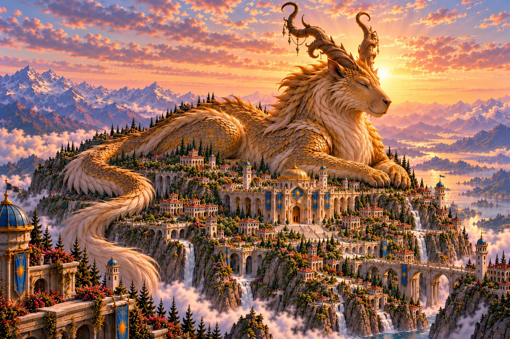
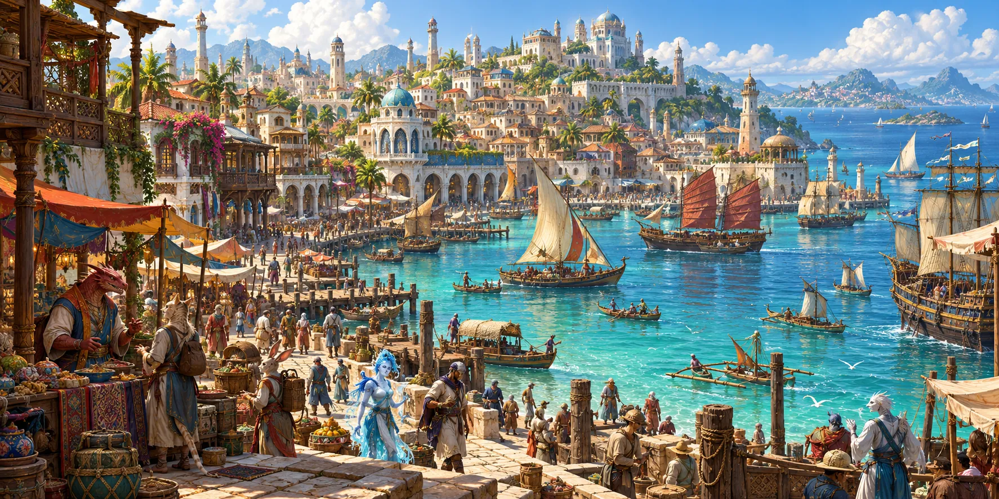
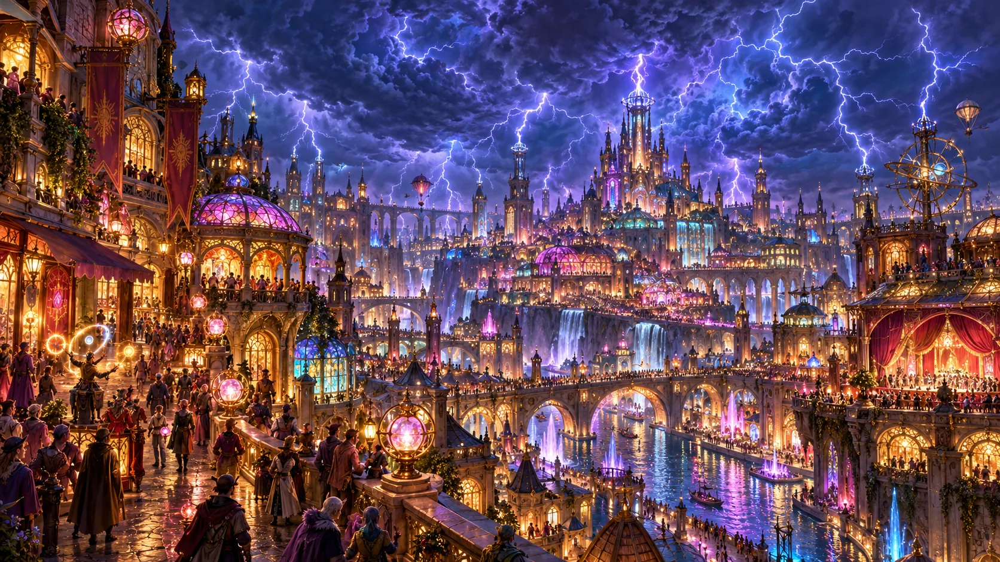
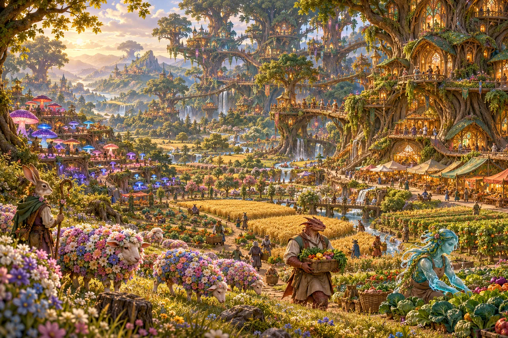
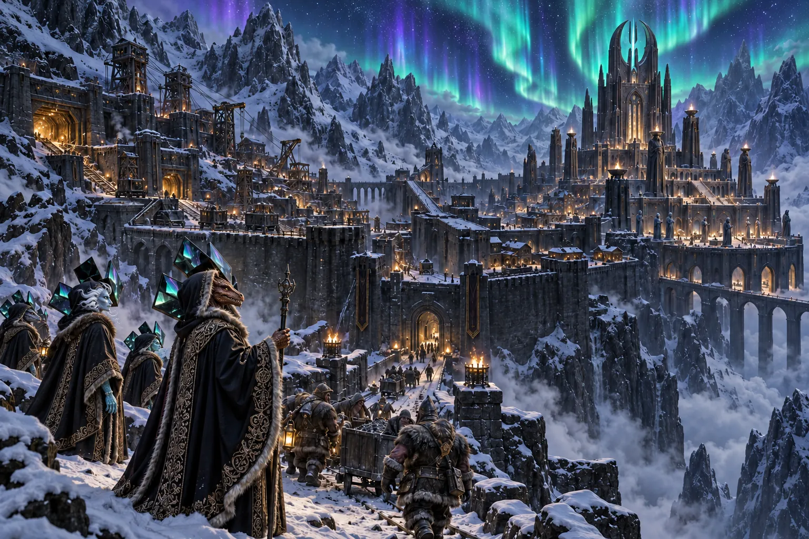

# Locations

This page tracks the known geography of our world, organized by region and importance.

## Enziret

::: danger _Status: Catastrophically Damaged / Restricted Access_
:::

- **Deity:** The God King Enzi
- **Description:** Formerly a massive kingdom built around the God King Enzi. It was renowned for its peaceful aura (granted by Enzi’s magical calming effect), high concentration of artisans, and lack of crime.
- **Current State:** Following a massive earthquake, the mountain erupted with lava and toxic gases. The God King is no longer visible or reachable.
- **Notes:** [RECORDS OF PRE-DISASTER LIFE ARE CURRENTLY BEING ARCHIVED]

### Enziret Passage

### Rockfall

::: warning _Status: Active Refugee Hub_
:::

- **Location:** A small town situated at the bottom of the mountain, below Enziret.
- **Description:** Rockfall serves as a somber refugee hub, nestled at the base of Mount Enziret in the wake of the catastrophic eruption. The air in town remains thick with the heavy scent of disaster—a mixture of smoke, ash, and the lingering smell of the swamp—as the streets sit partially flooded by the tides of Zanzibahar. While the town is currently a landscape of chaos and despair, it has become a vital sanctuary for those fleeing the destruction of the kingdom. Amidst the ruin, life persists in small pockets: the "Rockstop" sells Enzi memorabilia to those seeking a connection to the past, "Cave Divers" provides essential equipment, and local establishments like the "Dreaming Dragon Inn" and "The Fungus Jug" offer a place for weary travelers to find respite. Though battered by the disaster, Rockfall remains a beacon of survival for the displaced.

- **Notes:** Following the disaster, most inhabitants consider the town "Done-zos" and are leaving the town. Many are headed towards the nearest city of Zanzibahar.

### The Dreaming Dragon Inn

- **Description:** The Dreaming Dragon Inn serves as a primary hub in Rockfall, providing both sanctuary and administration for the displaced population. It is described as a rustic building where Magistrate Aja Appleborn maintains her home office, overseeing the local relief efforts and coordinating with the deputy constables. The inn also houses Silvie, the innkeeper.

### Cave Divers

- **Description:** Cave Divers is an essential equipment shop in Rockfall, managed by a blue-haired rock gnome named Tippy. The establishment serves as a staging area for those visiting/touring Mount Enziret, offering necessary mountain gear such as pickaxes, ropes, and "head-torches."

### Rockstop

- **Description:** Rockstop is an Enzi memorabilia shop that stands as a poignant site of cultural memory in Rockfall. Run by a heavily intoxicated Rock-Genasi, the shop is filled with items such as plushies, hats mimicking Enzi's horns, and T-shirts bearing cheeky slogans.

### The Fungus Jug

- **Description:** The Fungus Jug is a local tavern in Rockfall characterized by its heavy atmosphere and pungent smoke from "Sailor's Grass" (also known as Witch Wort or Sea Weed). The establishment is run by Herb, a man likely under the influence of recreational substances who provides travelers with fun drugs, drinks, and munchies. It is a place where the weary can chillax.

---

## Zanzibahar

- **Deity:** The Goddess Bahare
- **Description:** As the continent’s chief melting pot, Zanzibahar is where all paths meet. It is a city of bustling marinas and endless commerce—and more importantly, it remains the only place where one can cast off from these shores to reach distant lands.
- **Vibe:** "Pirates and mermaids on white sandy beaches."
- **Proximity:** Noted as the closest city to Enziret.

## Urusha

- **Deities:** The Twin Gods Hurun and Nurun
- **Description:** A kaleidoscope of technological innovation and high-energy social scenes. In Urusha, artifice meets excess; where streets hum with perpetual music and light, they also serve as a sprawling playground for clandestine trade and underworld empires.
- **Demographics:** A primary home for Artificers and Warforged.

## Mayua

- **Deity:** Goddess Mayren
- **Description:** The agricultural heart of the continent, devoted to Goddess Mayren. It consists of beautiful farmlands and ancient, twisty forests imbued with fey magic.
- **Inhabitants:** Primarily a home for farmers and druids.

## Nyalima

- **Deity:** Goddess Nyota
- **Location:** A desolate region high in the mountains.
- **Description:** A temple raised to Goddess Nyota. It serves as a primary training ground for priests of all religions.
- **Economy:** Supported by mountain miners who maintain a tense, at-odds relationship with the religious types.

---

## Geography & Travel Notes

### The Vast Oceans

The continent is isolated from other D&D cities by massive oceans. Traveling by sea to distant lands is possible but remains a significant undertaking.

### God-Touched Regions

Large cities are traditionally developed close to the domains of the gods, as inhabitants benefit significantly from being in proximity to their magic.

### Regional Status

- **Enziret:** Currently in a state of emergency.
- **Zanzibahar:** [Details pending]
- **Urusha:** [Details pending]
- **Mayua:** [Details pending]
- **Nyalima:** [Details pending]
