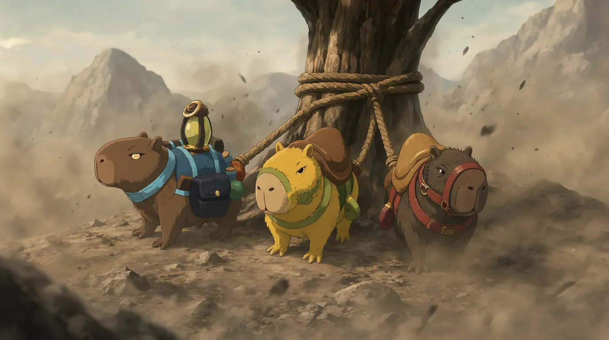

# Rockfall Residents

## Aja Appleborn

_Magistrate of Rockfall_

- **Name:** Aja Appleborn
- **Title:** Magistrate of Rockfall.
- **Description:** A short, tan woman with bright red hair and freckles, Aja is a recent widow whose spouse perished during the eruption of Mount Enziret.
- **Residence:** She lives and works in her office located upstairs within the rustic walls of the **Dreaming Dragon Inn**.
- **Leadership & Provisioning:** She publicly addressed the townsfolk from a podium outside the inn to coordinate volunteers for relief efforts (the party stepped forward to help). She pledged the town's support to the party’s cause and provided them with a single **Healing Potion**.
- **Intelligence Shared:**
  - The overland pass toward Mount Enziret is entirely inaccessible due to earthquakes and volcanic activity.
  - A local family (two parents and two children) is missing.
  - After being prompted by Noa's Insight, she revealed reports of terrifying monster sounds echoing near the area where the family was last seen.
- **Post-Quest Interaction:** Upon the party's return to Rockfall, she offered "heartfelt thanks" for the rescue of the family and hinted at the next task: escorting a group of travelers and Swamp Stompers along the treacherous Swamp Path toward **Zanzibahar**.

## Constable Joren

**Roles and Responsibilities:**

- **Title:** Constable Joren
- **Role:** Local Law Enforcement.
- **Responsibilities:** He oversees the deputy constables in Rockfall. During the events of Session 1, he was overseeing deputy constables who moved through the crowd to scout for information and monitor those gathered outside the Dreaming Dragon Inn.

**Key Interactions and Actions:**

- **During the Crisis:** He was involved in monitoring the situation in Rockfall following the fall of Enziret.
- **Aftermath:** Following the party's successful rescue of the missing family, Joren met with the party along with Magistrate Aja Appleborn to offer their heartfelt thanks for the daring rescue.

## Silvie

**Role and Location:**

- **Title:** Innkeeper
- **Location:** The _Dreaming Dragon Inn_ in Rockfall.

**Key Interactions and Actions:**

- **Provision of Meals:** She provided the party with a meal consisting of plain broth and vegetables.
- **Discovery:** It was during the meal she provided that various members of the party discovered hidden secret magical fortune cards.

## Rock-Genasi Merchant

**Identity and Physical Description:**

- **Race:** Rock-Genasi.
- **State of Being:** The merchant is described as being "heavily intoxicated."

**Business Details:**

- **Shop Name:** _Rockstop_.

- **Location:** Located in the town of Rockfall.

- **Specialty:** The shop is filled with Enzi memorabilia.

- **Inventory/Products:**
  - Hats that mimic Enzi's horns.
  - Various plushies (specifically mini-Enzi plushies).
  - Various T-shirts, many of which feature the cheeky message: _"I walked all the way from Rockfall and all I got was this stupid T-Shirt."_

**Interactions with the Party:** During the "Provisions and Preparations" phase before departing Rockfall, the party visited the merchant's shop:

- **Cassius's Actions:** He purchased five mini-Enzi plushies (intended to help calm frightened children) and five T-shirts for supplies.
- **Noa's Interaction:** She attempted to find a specific hat at the shop but was unfortunately unsuccessful in finding it.

## Tippy

**Identity and Role:**

- **Name:** Tippy
- **Race:** Rock Gnome
- **Appearance:** Described as having blue hair.
- **Role:** Merchant.

**Location and Business:**

- **Shop Name:** _Cave Divers_
- **Location:** Located in the town of Rockfall.
- **Specialty:** Sells essential gear for mountains and exploration.

**Inventory/Products:** During the party's visit to her shop, they secured the following items:

- Two pickaxes
- Two 50ft coils of rope
- A peculiar "head-torch" (a whimsical medieval take on a headlamp designed to help with visibility in dark places)

**Interactions with the Party:** The party visited Tippy's establishment during their preparations before departing Rockfall. While the party was conducting business, Sicarious managed to make off with a souvenir rock from the shop.

## Herb

**Identity and Role:**

- **Name:** Herb
- **Role:** Merchant
- **Location:** Located at _The Fungus Jug_ (a tavern in Rockfall).

**Physical State and Disposition:**

- **Condition:** He appeared to be "heavily under the influence of some recreational substance."
- **Outlook:** He expressed a grim outlook on the future of the town, stating it is "done'zos" and likely destined to be abandoned as people move toward Zanzibahar. He also mentioned that he might head for Urusha himself.

**Business and Inventory:**

- **Products Provided:**
  - Two days' worth of rations for each party member.
  - Ale.
  - A pouch of "Sea Weed" for each party member (though Noa gave her portion to Blaise).

- **Unique Reward:** He offered a unique reward for the party's success: a pipe shaped like Enzi.

**Interactions with the Party:** The party visited Herb at _The Fungus Jug_ during their preparations before departing Rockfall:

- **Provisioning:** The party received their rations, ale, and Sea Weed from him.
- **Knowledge Sharing:** During the interaction, information was learned regarding the distinct properties of local flora (Witch Wort, Sea Weed, and Sailor's Grass).
- **Reward Agreement:** He offered the party the Enzi-shaped pipe as a reward for their success.

## Swamp Stompers

**Nature and Characteristics:**

- **Type:** Creatures that function as domesticated mounts.
- **First Encounter:** The party encountered three Swamp Stompers thundering down the mountain. Barvin used Insight to determine they were fleeing, not attacking.
- **Interaction with Noa:** Noa managed to sneak up on one of the creatures and feed it food (costing -1 ration), which it ate "with relish."
- **Interaction with Cassius:** Cassius was playfully nipped by one of the creatures.
- **Capture/Wrangling:** Sicarious used a lasso to wrangle one of the creatures that had attempted to run away.
- **Calming the Animals:** Blaise played his clarinet, which successfully calmed the animals.
- **Acquisition:** The party decided to take all three Swamp Stompers along on their journey.
- **Rescue Assistance:** During the escape from the mountain, the Swamp Stompers arrived to assist the party by carrying the rescued children back toward the safety of Rockfall.

## Missing Family

- **Members:** A total of four people: two parents and two children.

**Location and Situation:**

- **Original Status:** Reported as missing by Magistrate Aja Appleborn after a mysterious sound (like a monster) was heard near their last known location.
- **Discovery:** The party found them inside the **Enziret Passage**, hidden within a formation of rocks in a massive open chamber.
- **Condition:** They were huddled together, hiding, and were in a state of "intense terror." Their eyes were wide with fear.

**Interactions with the Party:**

- **Communication:** Because they were terrified, they gestured for the party to be silent. Noa used _Magic Whisper_ to communicate with them, to which they responded with the single word: _"Monster."_
- **Disturbance:** The man (the father) was startled from his hiding spot and cried out in fear when the party drew near, which triggered a tremor and the appearance of a creature.
- **Rescue:** The party successfully navigated the crumbling tunnels to reach them. Following the battle with the monster (Kuona), the family was rescued.

**Aftermath:**

- **Safe Return:** The **Swamp Stompers** assisted in the rescue, carrying the children back toward the safety of Rockfall.
- **Resolution:** The party successfully completed the quest "The Missing Family" by returning everyone safely to the town.

---
